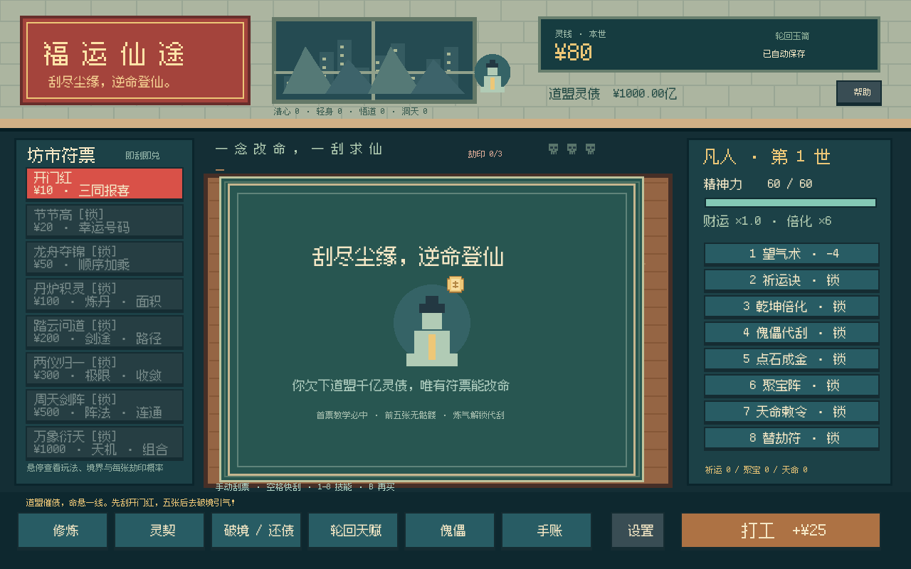
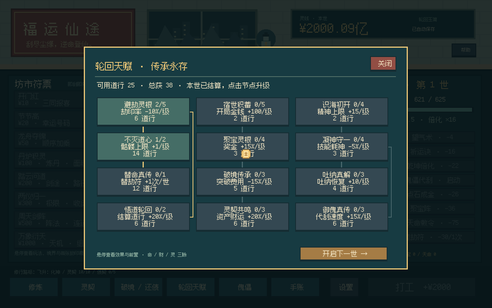

# 福运人生 · 福运仙途

**v0.3.0 · Godot 4.5.1 Standard · GDScript · Compatibility**

一名欠下道盟千亿灵债的凡人，在坊市小店用一枚硬币刮开符票。赚钱、购置灵车洞府、突破境界、修习神通；劫印满额便入轮回，把本世历练化为永久天赋，再来一世。



## 开始游玩

Windows 运行包解压后双击 `FuyunLife.exe`，不需要安装 Godot。源码用 **Godot 4.5.1 Standard** 导入 `project.godot` 后按 F6/F5 运行；无第三方插件。仓库内的 GitHub Actions「Export playable builds」可手动导出 Windows、Linux、Web 包。

1. 点击左边的开门红，按住鼠标左键拖动硬币。也可按住空格逐格快刮。
2. 首票教学必中，前五张无骷髅。历练五张、累奖 ¥50 后，去「破境 / 还债」花 ¥50 突破炼气。
3. 炼气解锁祈运、倍化和傀儡代刮。先祈运，再购票、望气、倍化；筑基后可改命或用有限的替劫符。
4. 精神**不会自动回复**。在「修炼」中主动吐纳，或购买灵茶、药浴等活动；洞府解锁自动付费修炼。
5. 每张符票最多一个骷髅。初始累计第三个即失败，致命票不兑奖。结算道行、升级轮回天赋，再开启下一世。
6. 达到化神、集齐十件灵契、实际偿清五重债契（累计 1000 亿）即可飞升。

快捷键：`1–8` 神通，`空格` 快刮，`B` 再买当前票种，`Esc` 关闭菜单。声音、减少动态、划过即刮均可在设置调整。

## v0.3 内容

| 符票 | 票价 | 玩法 | 基础中奖率 | 基础骷髅率/张 |
|---|---:|---|---:|---:|
| 开门红 | 10 | 三个相同数字兑奖 | 26% | 1.00% |
| 节节高 | 20 | 幸运号码匹配 | 25% | 1.17% |
| 龙舟夺锦 | 50 | 船员加乘，末位可能 ×0 | 24% | 1.34% |
| 丹炉积灵 | 100 | 宽×高的有符号积分面积 | 23% | 1.51% |
| 踏云问道 | 200 | 不越过地面、最终归位的路径与面积 | 22% | 1.68% |
| 两仪归一 | 300 | 有理式的无穷极限、收敛或过载 | 21% | 1.85% |
| 周天剑阵 | 500 | 灵源沿双向相接的符脉连通阵眼 | 20% | 2.02% |
| 万象衍天 | 1000 | 子集和与生成函数系数，计算达标组合数 | 19% | 2.19% |

所有数学票自动计算，不要求玩家手算。票面展示计算规则和奖档，奖金从实际符号重算。常规连空七张后第八张保底；祈运连续三张保第三档以上，票面头奖概率 10%。祈运与天命不会降低骷髅风险。

- **12 个永久天赋**：命、财、灵三条分支，有层数、价格与前置。减劫、增加骷髅上限、额外替劫符、初始金钱、技能减耗、吐纳与傀儡效率等。
- **6 个境界、8 个神通**：凡人→炼气→筑基→金丹→元婴→化神，必须同时满足金钱、历练、累计奖金、资产门槛。
- **6 种付费修炼 + 主动吐纳**：活动提供精神与有限票数的增益；高级活动需要境界和灵契。
- **灵车与洞府**：灵车加强倍化、代刮、活动折扣；洞府扩大识海、提高活动恢复量，并开放自动施法和自动修炼。
- **可控自动化**：在线购票、代刮、兑奖、祈运、望气→替劫→改命→倍化、付费修炼；保留备用金，菜单暂停，死亡停止。无离线收入，读档后须主动启动。
- **轮回结算**：按本轮累计彩票奖金的对数与资产件数发道行，防止大奖把局外成长直接灌满。已购票不可丢弃，也不能通过主动轮回来跳过危险票。



## 维护与验证

数值在 `data/*.json`，经济事务在 `scripts/core/game_state.gd`，数学票纯规则在 `scripts/core/mystic_rules.gd`，UI 不直接改钱包。持久存档 schema 3，支持 v0.1/v0.2 迁移；已购买的旧票保留原符号、奖金和刮开状态，不追加骷髅。

```bash
godot --headless --path . --editor --import
godot --headless --path . --script tests/run_tests.gd -- --test
godot --headless --path . --script tests/simulate.gd -- --test
# 有图形环境时执行实际渲染验收（不会写玩家存档）
godot --path . -- --smoke
```

- [设计与数值](docs/DESIGN.md)
- [开发、扩展与存档协议](docs/DEVELOPMENT.md)
- [资料来源与数学改编](docs/RESEARCH.md)
- [验证记录与限制](docs/VALIDATION.md)
- [更新日志](CHANGELOG.md)

本项目是原创单机原型，灵钱仅用于游戏内；没有真实投注或兑付。像素图形、音效由代码生成，中文字体使用 OFL 授权的 Fusion Pixel Font。详见 [第三方许可](THIRD_PARTY_LICENSES.md)。
